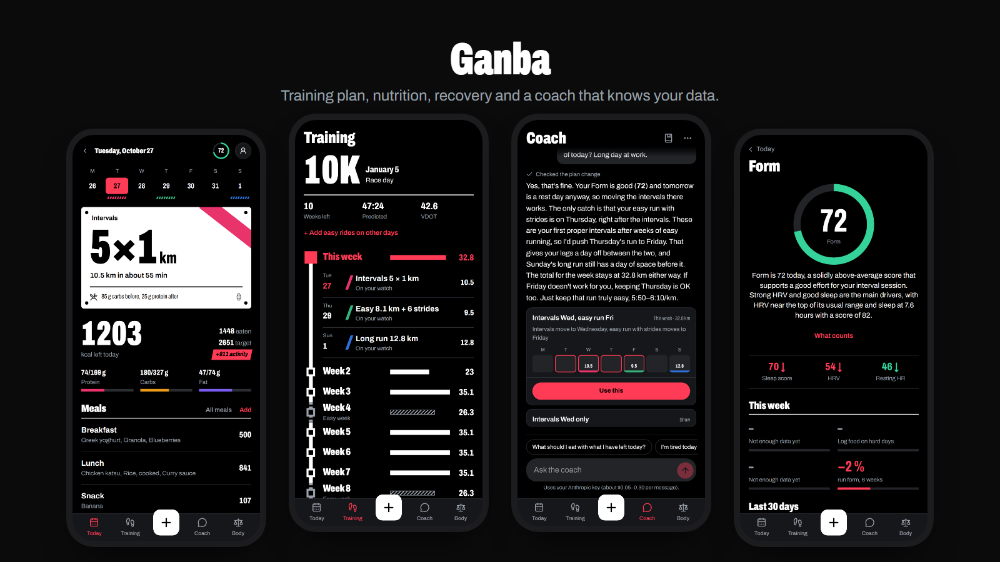
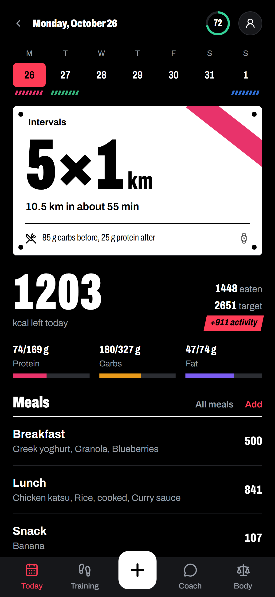
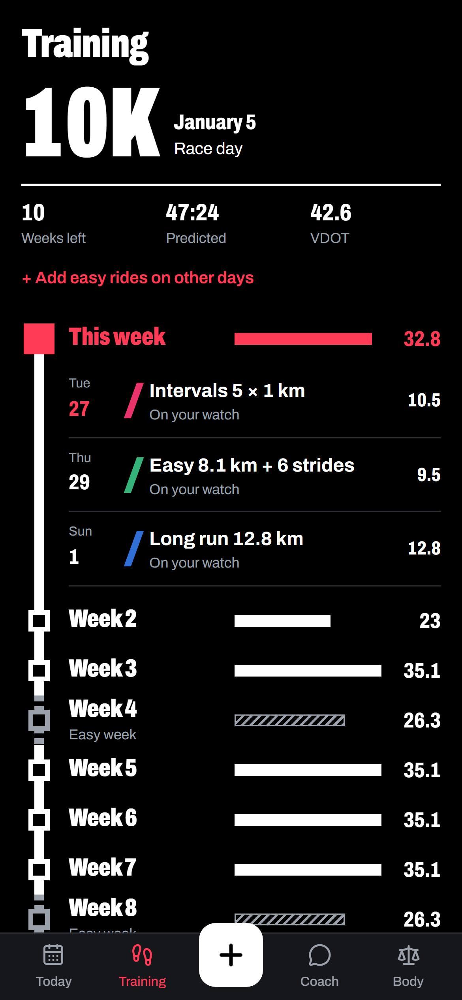
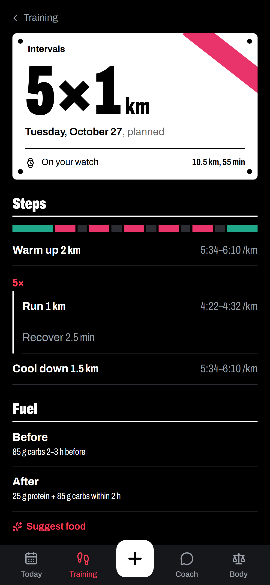
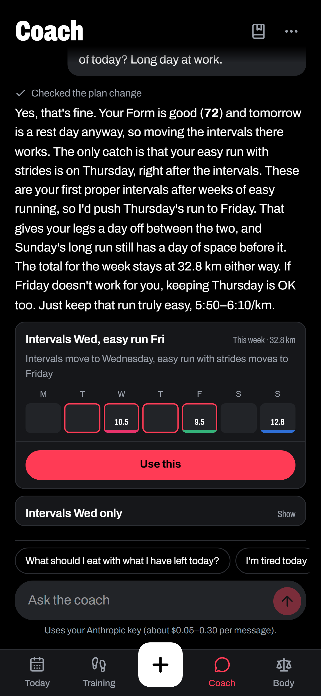
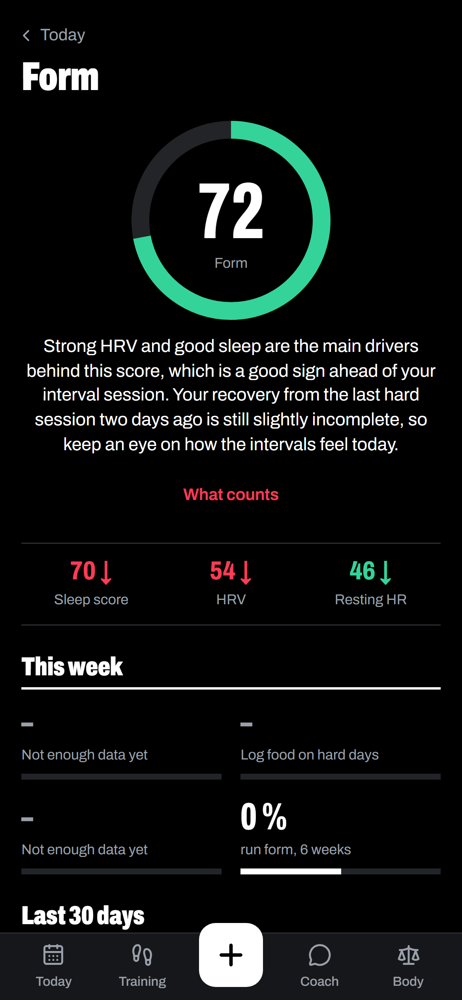
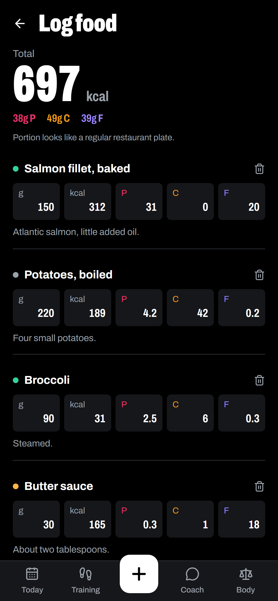
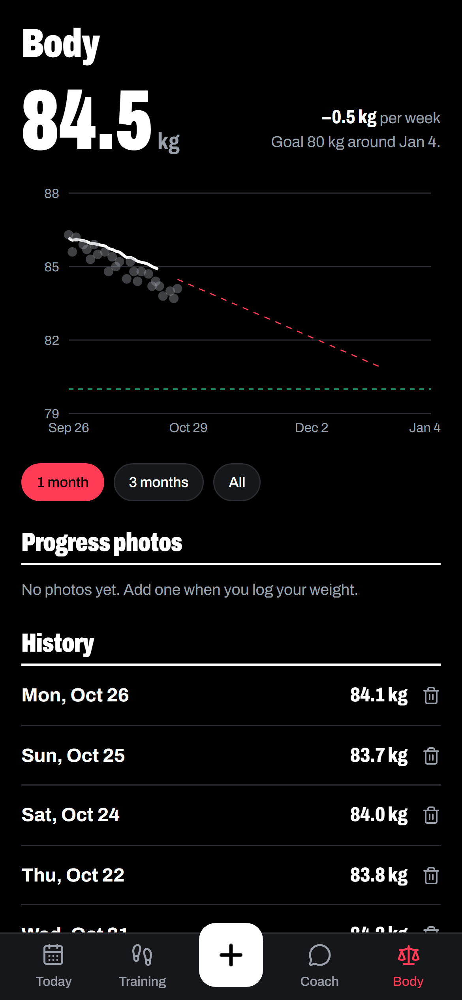
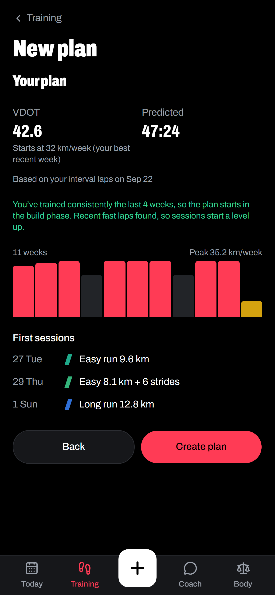

# Ganba

**One daily target that follows your training, and a coach that knows your data.**
A training plan, nutrition, recovery and weight tracking in one mobile web app, driven by your Garmin.

> *Ganba* (頑張って) is what Japanese runners shout to cheer each other on: "keep going, give it your all".

## Features

### Today
- Today's session as a race bib, with what to eat before and after.
- Calories left, macros, and how much today's activity added to your target.
- Form, a daily 0–100 readiness number from your sleep, HRV, resting heart rate, training load and food. Tap it to see what drives it.
- The week at a glance: which days you logged food and which sessions you did.

### Coach
- One ongoing conversation about anything: training, food, recovery and your body.
- It looks things up itself instead of asking: your food log, a session's laps and heart rate, sleep and HRV, weight, the plan.
- "I have 700 kcal left, what should I eat?" gets an answer that takes tomorrow's session into account, starting with a direction ("a teishoku with a full bowl of rice") and getting as concrete as you want.
- "I gave up after one interval" gets talked through: what came before (food, sleep, Form), what the laps show, what to change next time.
- It changes the plan when you ask: moves, rewrites or adds sessions, checks the load first, and says plainly when something is unwise.
- The answer streams in while the coach works, with a line showing what it is looking at.

### Training
- **Running:** plans for 5K, 10K, half marathon, marathon, or building fitness without a race, on the days you choose. Quality sessions rotate (short and long reps, threshold, race pace, fartlek, hills) with a 5K fitness test every eight weeks.
- **Cycling:** event or build plans driven by time and heart rate, with power targets when you have a power meter or smart trainer (ERG). Indoor season on a switch.
- **Both:** add easy rides to a running plan, or easy runs to a cycling plan, on days you pick.
- **Smart defaults:** paces, zones and the starting volume come from your recent sessions and Garmin. Weekly volume builds toward what your goal needs.
- **Garmin:** sessions go to your watch or Edge. The whole plan shows as a line map to race day.
- **Suggestions you accept:** a missed session, new paces, a lighter week.

### Nutrition and weight
- Log food from a photo or a short description. The app estimates grams, calories and macros, and you can correct it in plain text.
- Quick add when you already know the numbers.
- Trend weight that smooths out daily swings, with a forecast to your goal and private progress photos.
- A weekly check-in that adjusts your calorie target to what you actually burn.

### Garmin
- Steps, workouts, sleep and HRV sync automatically. Your daily target builds up through the day as you move.

## Screenshots

| Today | Training | Session | Coach | Form | Log food | Body | New plan |
|:---:|:---:|:---:|:---:|:---:|:---:|:---:|:---:|
|  |  |  |  |  |  |  |  |

Screenshots are made with `node scripts/screenshots.mjs` against a running app and a seeded demo user. With `ANTHROPIC_API_KEY` set, the coach screenshot is a real answer.

## Plan

| Phase | Scope | Status |
|---|---|---|
| 1 | Nutrition, food logging from photos, weight trend, weekly check-in | Done |
| 2 | Garmin sync, activity-based daily target, training plan on the watch | Testing |
| 2 | New design ("Tasuki"), new logo, light and dark mode | Done |
| 2 | Form: daily readiness from your own data | Done |
| 2 | Plan variety, build-fitness plans, fitness tests, hills | Done |
| 2 | Cycling plans with heart rate or power, combined running and cycling | Done |
| 2 | Coach v2: its own tab, food help, looks up your data, streaming answers | Done |
| Next | A coach that reaches out after a session that went badly; route/GPX import | Planned |
| Later | Strength sessions, native app | Ideas |
